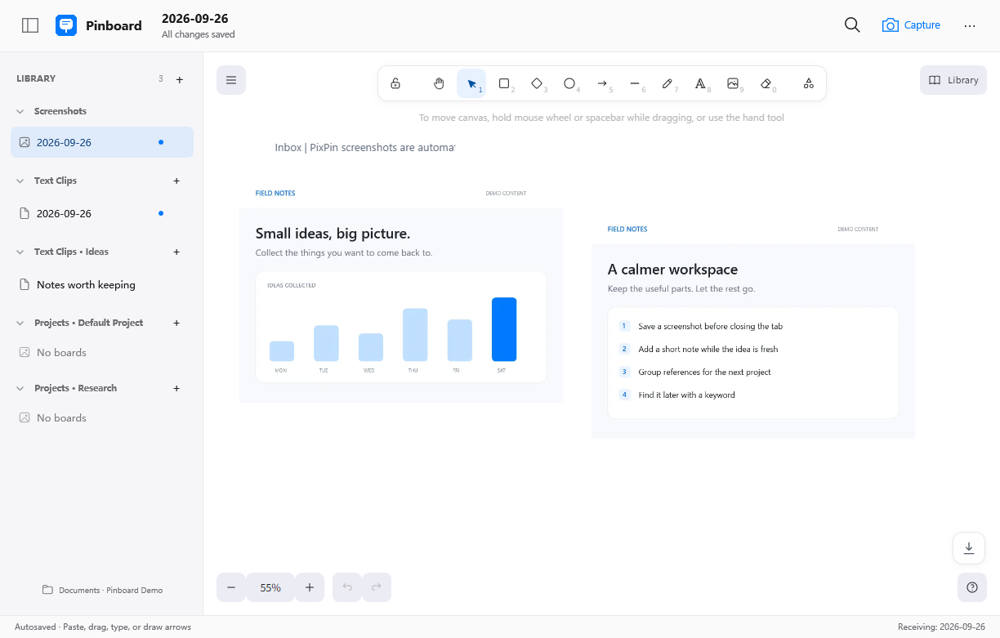
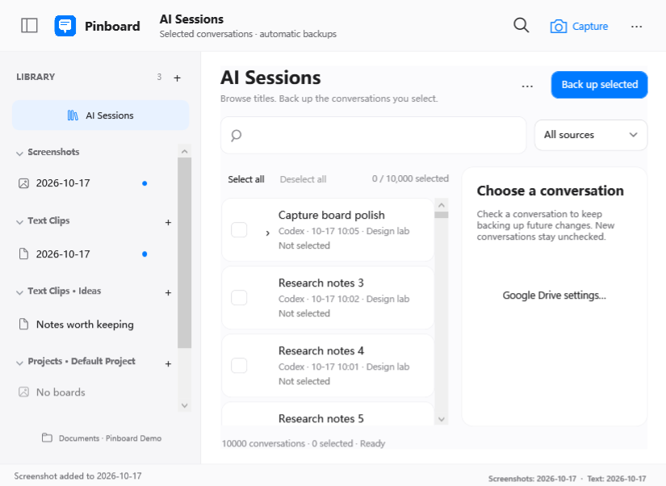
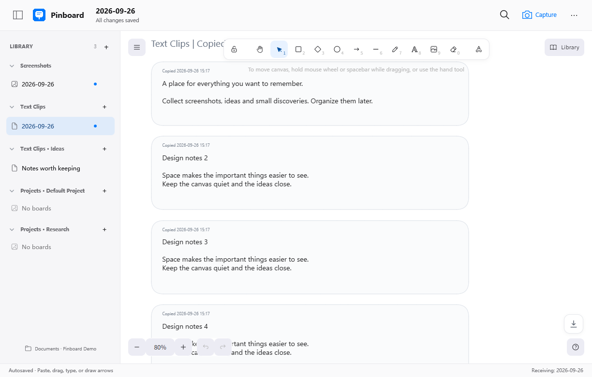
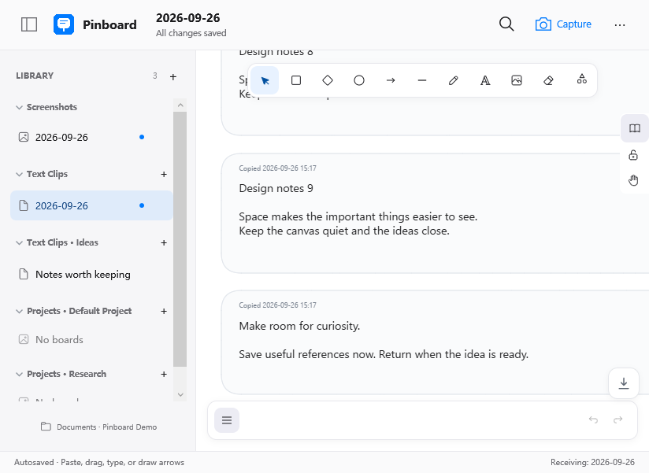

<p align="center">
  
</p>

# Pinboard

源码中的新版本增加轻量文字阅读模式：时间列表、完整原文、关键词高亮、本机收藏，以及仅折叠显示的重复内容分组。点击“画布”仍可编辑排版。截图与 OCR 任务先保存至本机恢复队列，重启后继续处理；正在打开的画板只增量传输新增图片。

**先收下，再慢慢整理。**

一个本地优先的 Windows 截图与文字剪藏工作台。用 PixPin 截图，在后台自动收集有用内容；需要时打开无限画布，拖动排版、补充文字，找回曾经复制过的灵感。

[English](README.md) · **简体中文**

[官网与交互演示](https://franklai.com/Pinboard/) · [下载 Windows 版](https://github.com/franklai-rise/Pinboard/releases/latest) · [0.8.4 更新说明](docs/releases/v0.8.4.md) · [MIT 许可证](LICENSE)



## 把有用的内容留下来

- **截图不用再粘贴一次。** Pinboard 运行时，照常使用 PixPin 的 `Ctrl+Alt+A`，完成后复制；截图自动进入当天画板或固定目标。
- **文字收集由你决定。** 手动开启后，复制的纯文字成为带时间戳的独立卡片。支持每日、每月、旧版单文件及固定目标。
- **自由排布的无限画布。** 拖动、缩放图片，添加文字、箭头、形状与自由笔；编辑能力基于 Excalidraw。
- **清楚的资料分栏。** 截图、文字、项目分开管理，支持自建文字文件夹与画板，历史月份默认折叠。修改显示名称不改变实际文件名。
- **复制过，也能找回来。** 在全部画板中搜索备注与本机中英文 OCR 结果，点击后定位原内容。
- **按需备份 AI 对话。** 提供 Codex、Claude Code、Antigravity 标题目录，子代理独立勾选、本地去重版本，以及可选的私有 Google Drive 备份。[连接与恢复教程](docs/ai-sessions.md)。
- **每张画板，一个文件。** 图片、场景与索引保存在同一个 SQLite `.pinboard` 文件中；支持 Excalidraw / Obsidian Excalidraw 导入及 PNG、SVG、`.excalidraw` 导出。

## 功能展示

### AI 对话目录与按需备份

0.8.4 提供独立标题目录，可逐项勾选或确认后**全选**，支持按标题和来源筛选后批量选择，包含匹配的折叠子对话。实时进度卡片区分已完成、排队、需重试与传输字节；**查看问题**可分类查看缺失文件与传输失败、处理建议及定向重试。只读的**重复与备份状态检查**区分相同内容、同名标题和正常的资源共享；**取消全选**保留已有备份。支持本地版本恢复和可选 Google Drive 上传与校验。[连接教程](docs/ai-sessions.md)。



### 文字剪藏，整齐地留住每一次复制

每次复制都生成一张卡片，包括重复复制。右下角“一键到底”可快速到达末尾，并保持当前缩放比例。



### 小窗口也能专注

单行顶部工具栏、悬停时显示的行内操作、可折叠侧栏，以及克制的蓝白配色。侧栏箭头有手形光标、淡蓝色圆角高亮、轻微按压反馈和展开动画；点击标题也能展开，新建按钮仍独立操作。右上角 **⋯ 更多** 可切换中英文。



以上为程序实际运行截图，内容均为虚构的演示资料。演示库标签替代了本机路径，不包含个人剪贴板历史。[截图生成方式](docs/screenshots.md)。

## 快速开始

1. 从 [Releases](https://github.com/franklai-rise/Pinboard/releases/latest) 下载 `Pinboard-windows-x64.zip`，解压并运行 `Pinboard.exe`。
2. 保持 PixPin 运行，按 `Ctrl+Alt+A` 框选，再用你配置的复制动作完成，例如 `Enter` 或 `Ctrl+C`。取消截图不会创建空白卡片。
3. 稍后打开 Pinboard，拖动排布、补充说明或搜索内容。
4. 若需要文字自动收集，在 **更多 → 设置** 中明确开启；想每天自动新建一张文字板，请选择 **每天一张**。
5. 左侧 **＋** 集中创建项目、画板与文字文件夹；右键画板可固定接收目标或恢复每日模式。

关闭窗口只是隐藏到托盘，已启用的收集会继续。要停止全部收集，请在托盘菜单选择 **退出**。设置中可关闭登录 Windows 后的后台启动。

**运行要求：** Windows x64（Windows 10 build 19041 或更新版本）、Microsoft Edge WebView2 Runtime；截图快捷键工作流需要 PixPin。便携包自带 .NET；OCR 需要相应 Windows 识别语言。程序目前未进行代码签名，Windows 可能显示信任提示。

## 后台更轻

0.7.3 的后台启动不加载浏览器画布。隐藏或最小化约 15 秒后，先确认编辑已保存，再释放画布与解码图片；重新打开时恢复画板和阅读位置。

一次开发机实测中，整个进程组的后台工作集从旧版 **646.9 MB** 降至新版打开画板再隐藏后的 **168.9 MB**，约下降 **74%**。这只是单机样本，不是固定内存承诺；大画板与 OCR 工作负载仍会需要更多内存。

## 保存位置与隐私

默认资料库为 `%USERPROFILE%\Documents\Pinboard`，可在设置中更改。

| 内容 | 资料库内的位置 |
| --- | --- |
| 每日截图 | `Screenshots\YYYY-MM-DD.pinboard` |
| 每日文字，需选择此模式 | `Text Clips\YYYY-MM-DD.pinboard` |
| 每月文字 | `Text Clips\YYYY-MM.pinboard` |
| 项目 | `项目名\画板名.pinboard` |

设置与故障恢复数据保存在 `%LocalAppData%\Pinboard`。

- 截图、文字与 OCR 在本机工作，无需账户、无遥测。可选 AI 对话云备份需要独立 Google 授权和逐项勾选，上传原始记录且不额外加密；画布禁止外部网络请求。
- **全新安装默认关闭文字收集。** 升级时保留已有的明确设置。
- 可选敏感信息过滤只是尽力减少误收，不能保证识别所有密码或私密内容；处理敏感内容前请暂停收集。
- `.pinboard` **不由 Pinboard 加密**，请配合 Windows 账户保护与磁盘加密。
- 图片首次导入时转为 WebP，默认质量 80，失败回退 PNG；日常保存不会反复压缩。
- 备份请使用 **保存副本**，或在停止编辑时复制整个画板文件；故障恢复不能代替日常备份。

## 构建与验证

在 Windows 上准备项目所需 .NET SDK、Node.js 与 WebView2，运行：

```powershell
.\scripts\build-release.ps1
```

脚本依次执行隐私检查、前端测试、依赖审计、.NET 测试与 Windows x64 自包含打包，成品位于 `artifacts\portable`。

当前验证结果见 [0.8.4 更新说明](docs/releases/v0.8.4.md)。200 MB 大画板基准、多显示器及完整高 DPI 测试矩阵不在本轮已验证范围内。

[详细使用说明](docs/使用说明.md) · [快捷键](docs/快捷键.md) · [验收记录](docs/验收记录.md)

[参与贡献](CONTRIBUTING.md) · [安全说明](SECURITY.md) · [第三方许可](THIRD-PARTY-NOTICES.txt)

基于 WPF、WebView2、React、TypeScript、Excalidraw、SQLite、SkiaSharp 与 Windows OCR。采用 MIT 许可证；本项目与 PixPin、Obsidian 或 Apple 无隶属关系。
